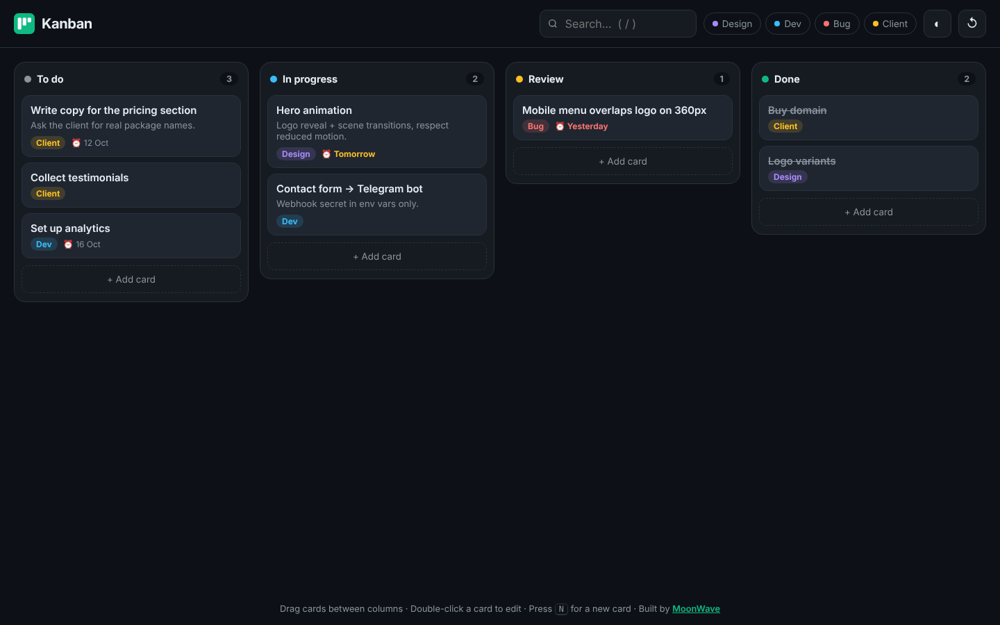
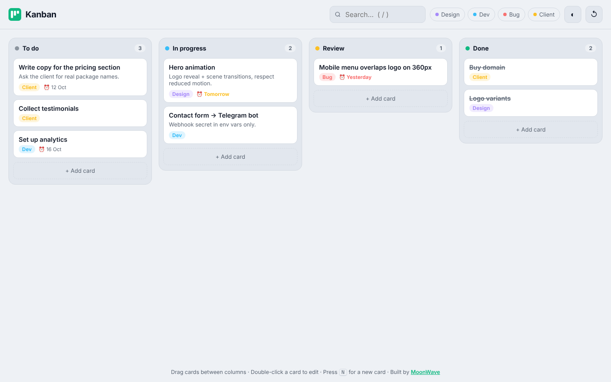

# Kanban Board

A fast, offline task board with smooth drag and drop, tags, due dates, search and dark mode. Everything is saved in your browser.





## Features

- Drag and drop between and within columns, built on Pointer Events, so it works with **mouse, touch and pen**
- Animated placeholder, tilted "ghost" card and auto-scroll near the screen edges
- Quick add (press <kbd>N</kbd>), double-click or <kbd>Enter</kbd> to edit
- Tags with colour filters, due dates with *overdue* / *soon* highlighting
- Instant search (press <kbd>/</kbd>)
- Delete with **Undo**
- Fully keyboard accessible: arrow keys to move focus, <kbd>Shift</kbd> + arrows to move cards
- Dark and light themes (follows the system by default)
- Autosave to `localStorage`
- Mobile layout with swipeable, snapping columns

## Tech

Vanilla JavaScript, HTML and CSS. No frameworks, no build step, no dependencies.

## Run locally

Open `index.html` in a browser, or:

```bash
npx serve .
```

## Need something like this?

I build web apps, tools and fast websites for small businesses and startups.

- Studio: [moonwave-studio.com](https://moonwave-studio.com)
- Hire me on [Upwork](https://www.upwork.com/freelancers/~01f7f6a71cc800d79b)

---

© MoonWave. All rights reserved. See [LICENSE](LICENSE).
